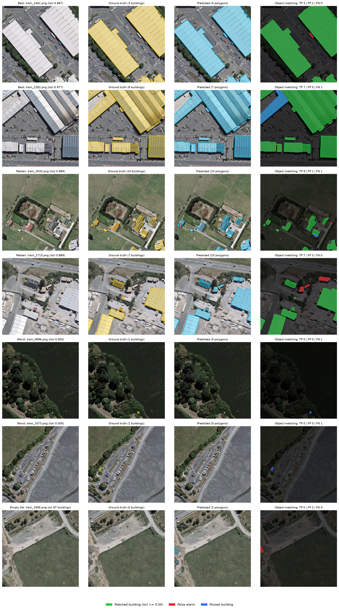
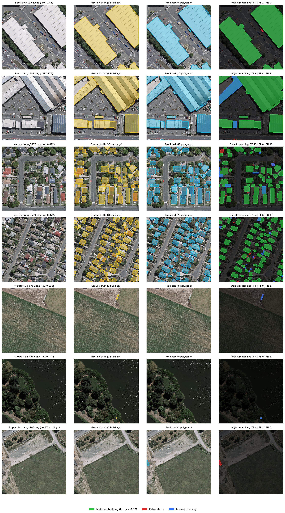
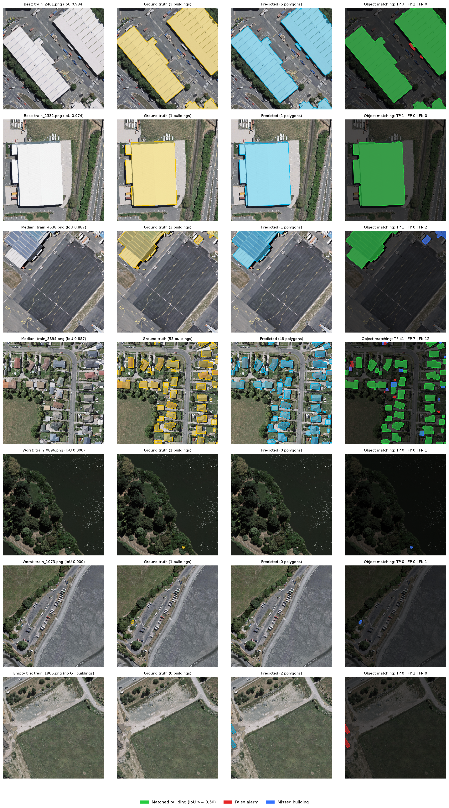

# 🛰️ Satellite Intelligence & Geospatial Computer Vision

> **An end-to-end Earth Observation computer vision prototype for satellite-image segmentation, building-footprint extraction, and geospatial analysis.**


## 📌 Overview

Satellite imagery provides a scalable way to monitor buildings, infrastructure, environmental changes, and urban development.

This project develops an **end-to-end computer vision prototype for Earth Observation**, beginning with high-resolution satellite imagery and building-footprint segmentation and extending through:

* Transformer-based segmentation
* Geospatial polygon extraction
* Model evaluation and error analysis
* API-based deployment (prototype)

The project is designed to bridge **deep learning research and practical ML engineering**.

> **Scope of this version.** This version covers data engineering, a U-Net baseline, a SegFormer-B0 comparison, an ensemble of the two, polygon extraction with object-level evaluation, and a prototype FastAPI service (ensemble model only) packaged as a Docker image. The API and the Docker image are the remaining work and are not built yet. Multi-temporal change detection (Phase 5) and model optimization (ONNX, TensorRT, latency benchmarking) are **not part of this version**; they are kept below as future work.

### Core Pipeline

```text
                 Satellite Imagery
                        │
                        ▼
              ┌───────────────────┐
              │ Data Preprocessing│
              └─────────┬─────────┘
                        │
                        ▼
                 Image Tiling
                        │
                        ▼
              Building Segmentation
                        │
              ┌─────────┴─────────┐
              ▼                   ▼
        CNN Baseline       Transformer Model
              │                   │
              └─────────┬─────────┘
                        ▼
                Segmentation Mask
                        │
                        ▼
               Polygon Extraction
                        │
                        ▼
                Geospatial Output
                        │
                        ▼
              Multi-Temporal Analysis
                        │
                        ▼
                 Change Detection
                        │
                        ▼
               Deployment / API
```

*Multi-temporal analysis and change detection are future work and are not part of this version (see the scope note above).*

---

# 🎯 Project Objectives

The primary objectives are to:

* Build a reproducible satellite-imagery data pipeline.
* Extract building footprints from high-resolution satellite imagery.
* Establish a CNN-based segmentation baseline.
* Evaluate transformer-based segmentation architectures.
* Convert segmentation masks into geospatial polygons.
* Investigate geographic generalization.
* Extend the pipeline toward multi-temporal change detection (future work, not part of this version).
* Perform quantitative and qualitative error analysis.
* Develop an inference pipeline and a prototype API (FastAPI, Docker).
* ONNX/TensorRT optimization (future work, not part of this version).

---

# 🗺️ Project Demonstration

> **This section will be populated as the project develops.**

### End-to-End Demo

<!-- IMAGE/GIF PLACEHOLDER
Add a short GIF or video showing:

Satellite Image
      ↓
Model Inference
      ↓
Building Segmentation
      ↓
Polygon Extraction
      ↓
Final Geospatial Visualization
-->

**Coming soon:** A complete visual demonstration of the inference pipeline.

---

# 📊 Dataset

## WHU Building Dataset (Hugging Face)

The initial dataset is the **WHU Building Dataset** (aerial imagery subset), hosted on the Hugging Face Hub.

Hugging Face mirror:

**https://huggingface.co/datasets/giswqs/WHU-Building-Dataset**

Original source and paper:

**https://gpcv.whu.edu.cn/data/building_dataset.html**

> Ji, S., Wei, S., & Lu, M. *Fully Convolutional Networks for Multisource Building Extraction from an Open Aerial and Satellite Imagery Data Set.* IEEE TGRS.

**License:** CC-BY-4.0 (as listed on the Hugging Face dataset page).

The dataset provides high-resolution aerial imagery with pixel-level building masks, organized into `Image/` and `Mask/` folders per split. It is fully open, requires no account or special tooling, and downloads with a single command via `huggingface_hub`.

### Why this dataset

* Open license and one-command download (no archives to extract).
* Image/mask pairs ready for segmentation, so the focus stays on modeling.
* Building footprints cover a dense, real urban area with varied building sizes and shapes.
* Large enough to train a U-Net and a SegFormer baseline on a single GPU.

### Known Limitations

* The aerial subset covers a **single region (Christchurch, New Zealand)**, so cross-city generalization cannot be measured directly from this dataset alone (see *Spatial Generalization* below).
* Annotations are provided as **raster masks**, not vector GeoJSON. Polygons are derived from masks in Phase 4. The preprocessed tensors carry no georeferencing, so polygons are expressed in 512×512 tile pixel coordinates (x = column, y = row, origin at the top-left, y pointing down) and the exported GeoJSON declares this in its `coordinate_system` field. Real map coordinates would need a per-tile geotransform, which the pipeline does not currently have.
* Only the `train` folder of the Hugging Face mirror was available, so it was split randomly 80/10/10 (seed 42) into train / validation / test (4586 / 573 / 573 tiles) during preprocessing. Because the split is random across tiles from one city, neighboring tiles can land in different splits, so the reported numbers are likely optimistic compared with a spatially disjoint split (see *Spatial Generalization* below).
* About 17% of tiles contain no buildings, and buildings make up roughly 15% of all pixels, so the classes are imbalanced and pixel accuracy alone is misleading.

### Dataset Structure

Conceptually:

```text
Aerial Image Tile
      +
Binary Building Mask
      │
      ▼
Preprocessing
      │
      ▼
Image Tile + Segmentation Mask
```

### Download

```bash
pip install huggingface_hub
py src/data/download_dataset.py          # train split
py src/data/download_dataset.py all      # full dataset
```

Data is stored under `data/raw/whu_building/`.

### Dataset Visualization

<!-- IMAGE PLACEHOLDER

Add a screenshot showing:

┌───────────────┬───────────────────┬──────────────────┐
│ Satellite     │ Building Polygons │ Rasterized Mask  │
│ Image         │                   │                  │
└───────────────┴───────────────────┴──────────────────┘

-->


---

# 🧭 Future Dataset — LEVIR-CD+

Change detection is **not part of this version**. A natural extension would use **LEVIR-CD+**, a building change-detection dataset available on the Hugging Face Hub, for multi-temporal analysis.

Hugging Face mirror:

**https://huggingface.co/datasets/blanchon/LEVIR_CDPlus**

The objective is to investigate how bi-temporal imagery can be used to identify newly constructed or removed buildings. Dataset details (pair structure, mask format, license) would need to be confirmed from the dataset card if this extension is pursued.

```text
Image T1 ───────────────┐
                        │
                        ▼
                  Feature Analysis
                        │
                        ▼
                 Change Detection
                        ▲
                        │
Image T2 ───────────────┘
```

---

# 🧠 Problem Definition

## Phase 1 — Building Footprint Segmentation

Given a satellite image:

```text
Input:
High-resolution satellite image

Output:
Pixel-level building segmentation mask
```

### Example

```text
Satellite Image
       │
       ▼
Segmentation Model
       │
       ▼
Building Mask
```

<!-- IMAGE PLACEHOLDER

Add:

Input Image | Ground Truth Mask | Model Prediction

-->

---

# 🛰️ Phase 2 — Geospatial Polygon Extraction

The segmentation mask will be transformed into structured building footprints.

```text
Segmentation Mask
       │
       ▼
Connected Components
       │
       ▼
Contour Extraction
       │
       ▼
Polygon Approximation
       │
       ▼
Building Footprints
```

### Example Output

<!-- IMAGE PLACEHOLDER

Show:

Satellite Image
+
Predicted segmentation
+
Extracted building polygons

-->

---

# 🕒 Future Work — Multi-Temporal Change Detection

*Not part of this version.* A possible final stage would investigate changes between satellite observations captured at different times.

Potential outputs include:

* Newly constructed buildings
* Removed buildings
* Modified building footprints
* Unchanged structures

### Before / After Visualization

<!-- IMAGE PLACEHOLDER

Add a side-by-side visualization:

Before → After → Detected Change

-->

---

# 🔬 Model Development

The project follows an incremental modeling strategy.

Rather than immediately adopting a complex architecture, a strong CNN baseline was established first and then compared against a transformer under the same training protocol.

---

## 1️⃣ CNN Baseline

The baseline is a U-Net with an ImageNet-pretrained ResNet18 encoder, built with `segmentation_models_pytorch`.

```text
Input Image
      │
      ▼
 CNN Encoder
      │
      ▼
Multi-scale Features
      │
      ▼
 U-Net Decoder
      │
      ▼
Building Mask
```

### Model Code Snapshot

```python
self.model = smp.Unet(
    encoder_name="resnet18",
    encoder_weights="imagenet",
    in_channels=3,
    classes=1,
)
```

---

## 2️⃣ Transformer-Based Segmentation

**SegFormer-B0** (`nvidia/mit-b0`) was trained under the same protocol. Its Mix Transformer encoder is ImageNet-pretrained and the decode head is newly initialized. SegFormer outputs logits at 1/4 of the input resolution, so they are upsampled to 512×512 and the same loss, trainer, and metrics apply unchanged.

```text
Satellite Image
      │
      ▼
Transformer Encoder
      │
      ▼
Multi-scale Representations
      │
      ▼
Segmentation Decoder
      │
      ▼
Building Mask
```

### Transformer Code Snapshot

```python
self.model = SegformerForSemanticSegmentation.from_pretrained(
    "nvidia/mit-b0", num_labels=1
)

def forward(self, x):
    logits = self.model(pixel_values=x).logits   # 1/4 resolution
    return F.interpolate(
        logits, size=x.shape[-2:],
        mode="bilinear", align_corners=False,
    )
```

---

# ⚖️ CNN vs Transformer

The baseline, the transformer, and an ensemble of the two were compared under consistent experimental conditions: same splits, loss, optimizer, learning rate, batch size, and number of epochs, with all predictions thresholded at 0.5. The ensemble averages the per-pixel probabilities of the U-Net and SegFormer-B0 and involves no extra training.

## 1. Pixel metrics on the validation set

| Model                              |    IoU |   Dice | Precision | Recall |     F1 | Pixel acc. |
| ---------------------------------- | -----: | -----: | --------: | -----: | -----: | ---------: |
| CNN / U-Net, ResNet18              | 0.8896 | 0.9416 |    0.9421 | 0.9411 | 0.9416 |     0.9830 |
| Transformer / SegFormer-B0         | 0.8775 | 0.9348 |    0.9411 | 0.9286 | 0.9348 |     0.9811 |
| Ensemble (U-Net + SegFormer-B0)    | 0.8933 | 0.9437 |    0.9484 | 0.9390 | 0.9437 |     0.9837 |

## 2. Pixel metrics on the test set

| Model                              |    IoU |   Dice | Precision | Recall |     F1 | Pixel acc. |
| ---------------------------------- | -----: | -----: | --------: | -----: | -----: | ---------: |
| CNN / U-Net, ResNet18              | 0.8857 | 0.9394 |    0.9415 | 0.9373 | 0.9394 |     0.9824 |
| Transformer / SegFormer-B0         | 0.8726 | 0.9320 |    0.9396 | 0.9245 | 0.9320 |     0.9803 |
| Ensemble (U-Net + SegFormer-B0)    | 0.8903 | 0.9420 |    0.9480 | 0.9361 | 0.9420 |     0.9832 |

## 3. 

> Metrics are computed from pixel counts accumulated over the whole split (573 tiles each). For binary segmentation with global counts, F1 is mathematically identical to Dice; both are listed because both are commonly reported. Validation numbers use each model's saved checkpoint (U-Net: epoch 33, SegFormer-B0: epoch 41). Re-evaluating the U-Net on the validation split with the evaluation script reproduces the training-time values (Dice 0.9416, IoU 0.8896). Inference latency was not measured in this version.

### Comparison

* **The U-Net is ahead of SegFormer-B0 on validation:** Dice 0.9416 vs 0.9348 (+0.0068), IoU 0.8896 vs 0.8775 (+0.0121), and a lower validation loss (0.0688 vs 0.0801). The same ordering holds on the test set (Dice 0.9394 vs 0.9320, IoU 0.8857 vs 0.8726).
* **The ensemble is best on every pixel metric on both splits, but by small margins.** On the test set its Dice is 0.9420 vs 0.9394 for the U-Net (+0.0026) and its IoU is 0.8903 vs 0.8857 (+0.0046); on validation the gains are +0.0021 Dice and +0.0037 IoU. Most of the gain comes from higher precision (test: 0.9480 vs 0.9415).
* **The U-Net/SegFormer gap is larger than typical epoch-to-epoch noise.** Over the last ten epochs the U-Net's validation Dice is mostly 0.939–0.943, while SegFormer-B0's is 0.925–0.933 from epoch 44 onward (after its epoch-42 spike).
* **All three models are slightly conservative:** precision is higher than recall on both splits (test: U-Net 0.9415 vs 0.9373, SegFormer-B0 0.9396 vs 0.9245, ensemble 0.9480 vs 0.9361), so they miss more building pixels than they invent.
* **Test scores are slightly below validation for every model** (for example U-Net IoU 0.8896 → 0.8857), which is expected because checkpoints were selected on validation. The split is random across tiles from one city, so both sets of numbers are likely optimistic compared with a spatially disjoint split.
* **Caveats:** one training run per model with no repeated seeds and no confidence intervals. SegFormer-B0 is the smallest SegFormer variant and was trained with the U-Net's learning rate without tuning. The ensemble gain is small and requires running both networks, so it costs roughly two forward passes per tile.
* The result therefore reads as "SegFormer-B0 did not beat the U-Net baseline under identical settings, and averaging the two gave a small further improvement", not as a general statement about transformers.

### Qualitative Comparison

Per-model test-set figures are in *Error Analysis* and *Geospatial Extraction* below. Each figure selects its tiles by that model's own per-tile IoU, so most tiles differ between models. A strict same-tile side-by-side (ground truth | U-Net | SegFormer-B0 on one fixed set of tiles) is still to be added.

---

# 🧪 Data Engineering Pipeline

A major focus of the project is making the dataset pipeline reproducible and reliable.

```text
Raw WHU Building Data
       │
       ▼
Mask Parsing & Binarization
       │
       ▼
Mask Validation
       │
       ▼
Image / Mask Alignment
       │
       ▼
Image Tiling / Cropping
       │
       ▼
Train / Validation / Test Split
       │
       ▼
PyTorch Dataset
```

### Preprocessing Visualization

<!-- IMAGE PLACEHOLDER

Show the transformation:

Original Aerial Image
        ↓
512×512 Tile (or smaller crops)
        ↓
Binary Building Mask
        ↓
Image / Mask Overlay
-->

---

# 💻 Representative Code

The README will include small code snippets that demonstrate important engineering decisions rather than reproducing entire source files.

## Example — Mask Loading

<!-- CODE PLACEHOLDER -->

```python
mask = load_binary_mask(
    mask_path,
    threshold=127
)
```

## Example — Model Inference

<!-- CODE PLACEHOLDER -->

```python
predictor = SegmentationPredictor.from_checkpoints(["unet", "segformer"])

probs = predictor.predict_each(images)   # {"unet": ..., "segformer": ..., "ensemble": ...}
```

## Example — Polygon Extraction

<!-- CODE PLACEHOLDER -->

```python
config = PolygonConfig(threshold=0.5, min_area_px=30, min_score=0.0, simplify_tolerance=1.0)

buildings = extract_buildings(probs["ensemble"][0].numpy(), config)
# -> list of Building(polygon, area_px, score)
```

> Full implementations are available in the `src/` directory.

---

# 📈 Training & Evaluation

## Training Curves

### U-Net (ResNet18 encoder)


A U-Net with an ImageNet-pretrained ResNet18 encoder was trained for 50 epochs with a BCE + Dice loss. The dashed line marks epoch 33, the checkpoint with the lowest validation loss and the one saved as the baseline model.

| Saved checkpoint (epoch 33) |  Value |
| --------------------------- | -----: |
| Validation loss             | 0.0688 |
| Validation pixel accuracy   | 0.9830 |
| Validation Dice             | 0.9416 |
| Validation IoU              | 0.8896 |

* Training loss keeps falling while validation loss plateaus around 0.07. The gap is modest (0.048 vs 0.071 at epoch 50) and validation loss does not trend upward, so there is no strong overfitting.
* Validation metrics are noisy from epoch to epoch (for example the dip at epoch 44).
* The best validation Dice (0.9428, epoch 48) is within 0.0012 of the saved checkpoint.
* Pixel accuracy is dominated by background. Buildings are only about 15% of pixels, so predicting "no building" everywhere would already score roughly 84–85% accuracy. Dice and IoU are the metrics to read.

### SegFormer-B0


SegFormer-B0 (`nvidia/mit-b0`) was trained for 50 epochs with the same loss, optimizer, learning rate, and batch size. The dashed line marks epoch 41, the checkpoint with the lowest validation loss.

| Saved checkpoint (epoch 41) |  Value |
| --------------------------- | -----: |
| Validation loss             | 0.0801 |
| Validation pixel accuracy   | 0.9811 |
| Validation Dice             | 0.9348 |
| Validation IoU              | 0.8775 |

* Training loss falls steadily, while validation loss is noisier. The gap at epoch 50 is modest (0.065 vs 0.081) and validation loss does not trend upward.
* There is a one-epoch validation spike at epoch 42: validation loss jumps from 0.0801 to 0.1871 and Dice drops from 0.9348 to 0.8418, while training loss stays in its normal range (0.0728). Validation recovers by epoch 44. The saved checkpoint (epoch 41) comes just before the spike.
* After the spike, validation Dice does not return to its epoch-41 peak and settles around 0.925–0.933.

---

## Evaluation Metrics

### Segmentation Metrics

* Intersection over Union (IoU)
* Dice coefficient
* Precision
* Recall
* F1 score
* Pixel accuracy

### Object-Level Metrics

Computed by `src/geospatial/evaluate_polygons.py`:

* Building detection precision, recall, and F1 (a predicted polygon is a true positive if it is matched one-to-one with a ground-truth building at IoU ≥ 0.5)
* Mean IoU of the matched buildings
* False-positive count and missed-building count
* False-positive polygons on tiles that contain no buildings

The ground truth is raster only, so ground-truth polygons are derived from the ground-truth masks with the same extraction (exact pixel-edge outlines, no simplification, no minimum area). Counts are per tile: a building cut by a tile edge counts separately in each tile it touches.

A predicted building polygon is a true positive when matched one-to-one to a ground-truth polygon at IoU ≥ 0.5. The results below use the default extraction settings, not the validation-sweep winners.

|Model	      | Precision	 | Recall	| F1	      | Mean matched IoU |
|-----------------|------------|----------|-----------|------------------|
|U-Net (ResNet18)	| 0.8847	 | 0.8216	| 0.8520	| 0.8695           |
|SegFormer-B0	| 0.8731	 | 0.8059	| 0.8381	| 0.8511           |
|Ensemble	      | 0.8967	 | 0.8262	| 0.8600	| 0.8679           |

The ensemble performs best overall on these test metrics, with a modest improvement over U-Net alone. Results use a random tile split from one region, so they may overestimate performance on geographically separate areas.

### Efficiency Metrics

Not evaluated in this version: no latency, throughput, memory, or model-size benchmark was run. The prototype API is planned to report the inference time of each request, which would give only a rough indication on whatever hardware it runs on. A proper efficiency study would measure:

* Inference latency
* Images per second
* Model size
* Memory usage
* Hardware requirements

---

# 🔍 Error Analysis

Model performance will not be evaluated solely through aggregate metrics.

Failure cases will be categorized and analyzed.

Potential categories include:

* Small buildings
* Dense urban regions
* Partially occluded buildings
* Shadows
* Low-contrast structures
* Complex building geometries
* Image artifacts
* Geographic domain shift

### Failure Case Visualization

#### U-Net (ResNet18 encoder)


#### SegFormer-B0


Tiles come from the test split and were chosen by per-tile IoU for each model (2 best, 2 median, 2 worst among tiles containing buildings, plus 1 empty tile), so each figure shows the range of behavior rather than a random sample. Because each figure selects tiles by its own model's IoU, most tiles differ between the two, and the median-tile IoUs (U-Net 0.887, SegFormer-B0 0.872) are not directly comparable. Columns: input, ground truth, prediction, and an error overlay (green = correct building, red = false alarm, blue = missed building).

What the examples show:

* Both models segment large, simple roofs such as industrial buildings almost perfectly (best tiles: IoU 0.984 and 0.974 for the U-Net, 0.985 and 0.975 for SegFormer-B0).
* Dense residential tiles sit around IoU 0.87–0.89, with errors on small outbuildings and along building edges. SegFormer-B0's predicted outlines appear softer and rounder, which fits its 1/4-resolution output.
* Both models miss the tiny buildings in their worst tiles (a handful of building pixels, IoU 0.00), and both miss the same tile (`train_0896`). Very small buildings are the clearest failure mode for both.
* On the one empty tile shown for both models (`train_1906`), each produces a small false alarm near the tile edge: 1,177 pixels for the U-Net and 574 for SegFormer-B0.
* On the shared tile `train_2461`, the two models score almost identically (IoU 0.984 vs 0.985).

These are qualitative observations from seven tiles per model, only three of which are shared. A quantitative breakdown by building size and tile type is still to be done.

---

# 🛰️ Geospatial Extraction (Phase 4)

Predicted probability maps are converted into building-footprint polygons by `src/geospatial/polygons.py`.

```text
Probability map
      │  threshold
      ▼
4-connected components
      │  drop small / low-confidence components
      ▼
Contour tracing (courtyards kept as holes)
      │
      ▼
Shapely polygon
      │  Douglas-Peucker simplification
      ▼
Building footprint
```

* **Components are 4-connected:** buildings that share an edge merge into one polygon, while buildings that only touch at a corner stay separate.
* **False-positive filtering:** `min_area_px` drops components with fewer pixels than the limit, and `min_score` drops components whose mean model probability is below the limit.
* **Pixel-edge outlines:** an unsimplified polygon has exactly the pixel count of its component for axis-aligned shapes and is within about 1–3% for diagonal or curved outlines, so polygon IoU is comparable to pixel IoU.
* **Simplification:** topology-preserving Douglas-Peucker with a 1-pixel tolerance. Courtyards are kept as polygon holes.

### Evaluation protocol

Post-processing settings were swept on the **validation** split (threshold 0.4 / 0.5 / 0.6, minimum area 10 / 30 / 60 / 100 px, minimum score 0 / 0.7, simplification fixed at 1 px; 24 configurations per model). The object-level **test** results below use the **default settings** (threshold 0.5, minimum area 30 px, minimum score 0, simplification 1 px), not the sweep winners. Scoring the validation-tuned settings on the test split has not been done.

### Validation sweep

Validation split: 573 tiles, 14,540 ground-truth buildings, object matching at IoU ≥ 0.5.

| Model      | Default settings: P / R / F1 | Best settings (threshold / min area / min score) | Best: P / R / F1         | ΔF1    |
| ---------- | ---------------------------- | ------------------------------------------------ | ------------------------ | -----: |
| U-Net      | 0.8885 / 0.8242 / 0.8551     | 0.4 / 10 / 0.7                                   | 0.9236 / 0.8159 / 0.8664 | +0.011 |
| SegFormer  | 0.8804 / 0.8048 / 0.8409     | 0.5 / 60 / 0.7                                   | 0.9223 / 0.7988 / 0.8562 | +0.015 |
| Ensemble   | 0.8982 / 0.8237 / 0.8593     | 0.5 / 10 / 0.7                                   | 0.9432 / 0.8135 / 0.8736 | +0.014 |

* A minimum score of 0.7 is part of the best configuration for all three models. It mainly removes low-confidence false-positive blobs: precision rises by about 3.5–4.5 points while recall drops by about 0.6–1 point.
* Without a score filter, lower thresholds produce more false alarms on empty tiles (for the ensemble, 19 polygons at threshold 0.4 / min area 10 / min score 0, versus 3 with min score 0.7).
* The optimum is flat: for the U-Net the four best configurations are within about 0.001 F1, so the exact winner should not be over-read. The U-Net and ensemble winners also sit at the edge of the grid (minimum area 10 px; threshold 0.4 for the U-Net), so a wider sweep might move them slightly.

### Object-level results on the test set (default settings)

Test split: 573 tiles (87 without any ground-truth building), 14,927 ground-truth buildings, matching at IoU ≥ 0.5.

| Model      | Predicted | TP     | FP    | Missed | Precision | Recall |     F1 | Mean matched IoU | FP polygons on empty tiles |
| ---------- | --------: | -----: | ----: | -----: | --------: | -----: | -----: | ---------------: | -------------------------: |
| U-Net      |    13,863 | 12,264 | 1,599 |  2,663 |    0.8847 | 0.8216 | 0.8520 |           0.8695 |                          3 |
| SegFormer  |    13,777 | 12,029 | 1,748 |  2,898 |    0.8731 | 0.8059 | 0.8381 |           0.8511 |                          2 |
| Ensemble   |    13,754 | 12,333 | 1,421 |  2,594 |    0.8967 | 0.8262 | 0.8600 |           0.8679 |                          1 |

* The ordering matches the pixel metrics: ensemble (F1 0.8600) > U-Net (0.8520) > SegFormer-B0 (0.8381). The ensemble has both fewer false positives (1,421 vs 1,599) and fewer misses (2,594 vs 2,663) than the U-Net.
* **Recall is the limiting factor.** Even the ensemble misses about 17% of the buildings (2,594 of 14,927) at IoU ≥ 0.5, while precision is about 0.90.
* Matched buildings overlap their ground truth with a mean IoU of 0.85–0.87.
* Very few polygons are produced on tiles without buildings (1–3 across 87 empty test tiles).

### Ceiling check

Feeding the ground-truth mask through the same extraction as if it were a prediction (validation split, default settings) gives precision 1.000, recall 0.9669 (482 of 14,540 buildings lost), F1 0.9831, and mean matched IoU 0.9636. The conversion itself therefore caps object-level recall near 0.97 and matched IoU near 0.96, so most of the models' remaining gap comes from the models rather than from the polygon conversion. The lost buildings are most plausibly the tiny ones removed by the 30-pixel minimum-area filter, but the effects of the minimum area and of simplification were not measured separately.

### Polygon visualizations

Columns: input, ground-truth polygons, predicted polygons, and object matching (green = matched building at IoU ≥ 0.5, red = false alarm, blue = missed building). Tiles come from the test split and are chosen by each model's per-tile pixel IoU (2 best, 2 median, 2 worst among tiles containing buildings, plus 1 empty tile). All figures use the default settings.

#### Ensemble (U-Net + SegFormer-B0)



#### SegFormer-B0



#### U-Net (ResNet18 encoder)



What the examples show:

* Large, simple roofs are matched cleanly. On `train_2461`, the best tile in all three figures, every ground-truth building is matched by every model (tile IoU 0.987 ensemble, 0.985 SegFormer-B0, 0.984 U-Net), with one or two small false-alarm polygons in the yard (ensemble 1, SegFormer-B0 1, U-Net 2).
* Dense residential tiles are where buildings are missed. In the median tiles shown, roughly 77–79% of ground-truth buildings are matched (SegFormer-B0 `train_0567`: 43 of 55; SegFormer-B0 `train_3589`: 64 of 81; U-Net `train_3894`: 41 of 53). The missed buildings are mostly small structures, with a handful of false alarms per tile.
* Tiny buildings are the clearest failure mode, now at the object level too. The worst tile in each figure contains a single tiny building and no predicted polygon (`train_0896` in all three, `train_1073` for the ensemble and U-Net, `train_0760` for SegFormer-B0).
* On `train_2282`, the ensemble matches 7 of 8 buildings with no false alarms, while SegFormer-B0 matches 6 of 8 with 4 false alarms. Both miss the same large warehouse at the top-left.
* On the empty tile `train_1906`, the models produce 2 (ensemble), 1 (SegFormer-B0) and 2 (U-Net) false-alarm polygons near the left edge of the tile.

These are qualitative observations from seven tiles per model, and the tiles differ between figures except for `train_2461`, `train_0896`, and `train_1906`, which appear in all three.

### Limitations

* **Adjacent buildings merge.** A semantic mask cannot separate buildings that share an edge, so a row of attached houses becomes one polygon. This lowers object-level recall and cannot be fixed with thresholds; an instance-splitting step (for example watershed) is future work. Its effect has not been quantified.
* **Pixel coordinates only.** The preprocessed tiles carry no georeferencing, so polygons are in tile pixel coordinates (see *Known Limitations*).
* **Optimistic split.** The random tile split means object-level numbers are likely optimistic compared with a spatially disjoint split.
* **Default settings on test.** The reported test results do not use the validation-tuned settings (see *Evaluation protocol*).

### GeoJSON output

`src/geospatial/export.py` writes one GeoJSON `FeatureCollection` per tile. Each feature is a `Polygon` with the properties `id`, `area_px` (component pixel count), `score` (mean model probability), and `model`. The collection also declares its coordinate system, so it is not mistaken for WGS84 data:

```json
{
  "type": "FeatureCollection",
  "coordinate_system": "pixel",
  "name": "<tile>.png",
  "y_axis": "down",
  "image_size": [512, 512],
  "features": [
    {
      "type": "Feature",
      "geometry": {"type": "Polygon", "coordinates": [[[x, y], ...]]},
      "properties": {"id": 0, "area_px": 0, "score": 0.0, "model": "ensemble"}
    }
  ]
}
```

*(Structure only; the values above are placeholders.)* The exports generated so far are for `train_0896`, which has no predicted polygons for any model, so those files contain an empty feature list. An example file for a tile with predicted buildings is still to be added. If a per-tile geotransform becomes available, the exporter can write map coordinates instead.

### Reproducing the Phase 4 results

```bash
python -m src.visualizationAndEvaluation.evaluate_test --split test         # pixel metrics, all models
python -m src.geospatial.evaluate_polygons --arch ensemble --split val --sweep
python -m src.geospatial.evaluate_polygons --arch ensemble --split test     # object-level metrics
python -m src.geospatial.visualize_polygons --arch ensemble                 # polygon figure
python -m src.geospatial.export --arch ensemble --tiles train_2461          # GeoJSON for one tile
python -m pytest tests                                                      # unit tests
```

Use `--arch unet` or `--arch segformer` for the single models, and `--arch oracle` for the ceiling check.

---

# 🌍 Spatial Generalization

One of the important questions in satellite-image ML is whether a model trained on one area generalizes to another.

The WHU aerial subset covers a single region, so the project will investigate generalization in two ways:

```text
Spatially disjoint split (same city, non-overlapping areas)
        │
        ▼
       Model
        │
        ├──────────► Held-out area evaluation
        │
        └──────────► Optional cross-dataset evaluation
                     (e.g. INRIA Aerial Image Labeling on Hugging Face)
```

This helps distinguish memorization of local appearance from genuine visual generalization. Cross-dataset evaluation is optional and will only be reported if actually performed.

---

# 🧩 Project Architecture

The project follows a modular ML-system design.

```text
                 ┌──────────────────┐
                 │ Satellite Images │
                 └────────┬─────────┘
                          │
                          ▼
                ┌────────────────────┐
                │ Data Preprocessing │
                └─────────┬──────────┘
                          │
                          ▼
                   ┌─────────────┐
                   │ Image Tiling│
                   └──────┬──────┘
                          │
                          ▼
                ┌─────────────────────┐
                │ Dataset / DataLoader│
                └──────────┬──────────┘
                           │
              ┌────────────┴────────────┐
              ▼                         ▼
       ┌────────────┐            ┌──────────────┐
       │ CNN Model  │            │ Transformer  │
       │ Baseline   │            │    Model     │
       └──────┬─────┘            └──────┬───────┘
              │                         │
              └────────────┬────────────┘
                           ▼
                  ┌─────────────────┐
                  │ Model Evaluation│
                  └────────┬────────┘
                           │
                           ▼
                ┌────────────────────┐
                │ Polygon Extraction │
                └─────────┬──────────┘
                          │
                          ▼
                  ┌───────────────┐
                  │ Geospatial    │
                  │ Visualization │
                  └───────┬───────┘
                          │
                          ▼
                 ┌─────────────────┐
                 │ Change Detection│
                 └─────────────────┘
```

*Change detection is future work and is not part of this version.*

### Architecture Diagram

<!-- IMAGE PLACEHOLDER

Replace the ASCII architecture above with a professionally designed architecture diagram once the implementation stabilizes.

-->

---

# 📁 Repository Structure

```text
satellite-intelligence/
│
├── configs/
│   └── config.yaml
│
├── data/
│   ├── raw/
│   │   └── whu_building/
│   │       ├── .cache/
│   │       └── train/
│   │    
│   └── processed/
│       ├── train/
│       ├── val/
│       └── test/
│
├── results/
│   ├── demos/
│   │   ├── end_to_end_demo.gif
│   │   └── api_demo.gif
│   │
│   ├── diagrams/
│   │   └── system_architecture.png
│   │
│   ├── geojson/
│   │
│   ├── visualizations/
│   │   ├── learning_curves.png
│   │   ├── learning_curves_transformer.png
│   │   ├── mask_check.png
│   │   ├── whu_test_predictions.png
│   │   ├── whu_test_predictions_transformer.png
│   │   ├── whu_test_polygons_unet.png
│   │   ├── whu_test_polygons_segformer.png
│   │   └── whu_test_polygons_ensemble.png
│   │
│   ├── pixel_metrics_val.csv
│   ├── pixel_metrics_test.csv
│   ├── polygon_metrics_{unet,segformer,ensemble}_test.json
│   ├── polygon_metrics_oracle_val.json
│   └── polygon_sweep_{unet,segformer,ensemble}_val.csv
│
├── src/
│   ├── code/
│   │   ├── __init__.py
│   │   ├── alignment_check.py
│   │   ├── check_masks.py
│   │   ├── dataset_visualization.py
│   │   ├── dataset.py
│   │   ├── loss.py
│   │   ├── metrics.py
│   │   ├── model.py
│   │   ├── preprocessing.py
│   │   ├── segformer.py
│   │   └── trainer.py
│   │
│   ├── data/
│   │   └── download_dataset.py
│   │
│   ├── visualizationAndEvaluation/
│   │   ├── visualize_unet.py
│   │   ├── visualize-segmentation_transformer.py
│   │   └── evaluate_test.py
│   │
│   ├── inference/
│   │   └── predictor.py
│   │
│   └── geospatial/
│       ├── polygons.py
│       ├── evaluate_polygons.py
│       ├── visualize_polygons.py
│       └── export.py
│
├── tests/
│   ├── conftest.py
│   └── test_geospatial.py
│
├── train.py
├── unet_best_model.pth
├── unet_training_log.csv
├── segformer_mit-b0_best_model.pth
├── segformer_mit-b0_training_log.csv
├── requirements.txt
├── Dockerfile
└── README.md
```

---

# 🚀 Deployment

A prototype inference service is the remaining work for this version. **It is not built yet.** It will serve the **ensemble model only** (the average of the U-Net and SegFormer-B0 probabilities, the best configuration in the evaluation above) and will be packaged as a Docker image. Because it is a prototype rather than a production service, it runs both networks on every image, which is roughly twice the cost of a single model, and it has no latency target.

```text
Satellite Image
       │
       ▼
     FastAPI
       │
       ▼
 Model Inference (ensemble)
       │
       ▼
Segmentation Mask
       │
       ▼
Polygon Extraction
       │
       ▼
Geospatial Response
```

### API Demo (preview)

The animation below is a **preview of the intended workflow**, from image upload and model inference to building-mask visualization. It is not a recording of a running service, and it will be replaced with a recording once the API exists.


---

# ⚡ Model Optimization (Future Work)

Not part of this version. A possible path for future work:

```text
PyTorch Model
      │
      ▼
    ONNX
      │
      ▼
ONNX Runtime
      │
      ▼
TensorRT
      │
      ▼
Optimized Inference
```

Any future optimization results should be measured rather than assumed.

### Benchmark

Not measured: no latency, throughput, or memory benchmark was run for this version.

---

# 🧪 Reproducibility

Both models were trained with the settings below (only the `model` block differs). Training settings are currently set in the training script; moving them into a YAML config is planned.

```yaml
dataset:
  name: whu_building
  tile_size: 512            # images and masks resized to 512x512
  split: random 80/10/10, seed 42   # 4586 / 573 / 573 tiles

training:
  batch_size: 4
  gradient_accumulation_steps: 2    # effective batch size 8
  epochs: 50
  optimizer: AdamW
  learning_rate: 0.0001
  weight_decay: 0.0001
  loss: BCE + Dice (0.5 / 0.5)
  mixed_precision: true             # on CUDA

model:                              # two separate runs
  - architecture: unet
    encoder: resnet18               # ImageNet-pretrained
    library: segmentation_models_pytorch
  - architecture: segformer
    pretrained: nvidia/mit-b0       # ImageNet-pretrained encoder, new decode head
    library: transformers

evaluation:
  checkpoint_selection: lowest validation loss
  threshold: 0.5
  pixel_metrics:                    # validation and test, per model and ensemble
    - iou
    - dice
    - precision
    - recall
    - f1
    - pixel_accuracy
  ensemble: mean of U-Net and SegFormer-B0 probabilities (no extra training)

polygon_extraction:
  connectivity: 4
  threshold: 0.5                    # defaults, used for the reported test results
  min_area_px: 30
  min_score: 0.0
  simplify_tolerance_px: 1.0
  object_match_iou: 0.5
  validation_sweep:
    threshold: [0.4, 0.5, 0.6]
    min_area_px: [10, 30, 60, 100]
    min_score: [0.0, 0.7]
    simplify_tolerance_px: [1.0]
```

---

# 🔬 Research Questions

### RQ1

How effectively can deep-learning models extract building footprints from high-resolution satellite imagery?

### RQ2

How does a transformer-based segmentation architecture compare with a CNN-based baseline?

### RQ3

How well do models generalize to spatially held-out areas, and optionally to a different dataset?

### RQ4

How accurately can pixel-level predictions be converted into usable geospatial building polygons?

### RQ5

Can multi-temporal satellite imagery be used to identify urban development and structural changes? *(Future work; not addressed in this version.)*

### RQ6

What is the trade-off between segmentation accuracy and inference efficiency? *(Not addressed in this version; no latency benchmark was run.)*

---

# 🛠️ Technology Stack

### Programming

* Python 3.x

### Deep Learning

* PyTorch
* torchvision
* segmentation_models_pytorch
* Hugging Face Transformers

### Computer Vision

* OpenCV
* Pillow
* Albumentations

### Geospatial

* Shapely (used in Phase 4)
* Rasterio (planned)
* GeoPandas (planned)
* GDAL (planned)

### Data & Analysis

* NumPy
* Pandas
* Hugging Face Hub (`huggingface_hub`)
* Matplotlib
* Jupyter

### Engineering

* Git
* Docker (planned)
* pytest
* YAML configuration
* Structured logging
* Modular/OOP architecture

### Deployment

* FastAPI (planned, prototype)
* ONNX (not used)
* ONNX Runtime (not used)
* TensorRT (not used)

---

# 🗺️ Development Roadmap

## Phase 0 — Project Setup

- [x] Define project specification
- [x] Create repository structure
- [x] Configure Python environment
- [x] Configure logging
- [x] Add configuration system
- [x] Document dataset acquisition

---

## Phase 1 — Dataset Engineering

* [x] Download WHU Building Dataset from Hugging Face
* [x] Inspect imagery
* [x] Inspect building masks
* [x] Validate image/annotation alignment
* [x] Binarize and validate masks
* [x] Resize images and masks to 512×512
* [x] Create train/validation/test splits
* [x] Build PyTorch Dataset
* [x] Visualize annotations

**Documentation milestone:**

* [x] Dataset visualization screenshot
* [x] Preprocessing visualization
* [x] Dataset pipeline diagram

---

## Phase 2 — CNN Baseline

* [x] Implement segmentation model
* [x] Implement training pipeline
* [x] Implement loss functions
* [x] Train baseline
* [x] Evaluate metrics
* [x] Generate prediction visualizations
* [x] Perform error analysis

**Documentation milestone:**

* [x] Training curves
* [x] Prediction examples
* [x] Failure cases
* [x] Baseline metrics

---

## Phase 3 — Transformer Segmentation

* [x] Implement/adapt SegFormer
* [x] Establish consistent evaluation protocol
* [x] Train transformer model
* [x] Compare against CNN baseline
* [x] Analyze performance differences

**Documentation milestone:**

* [ ] Architecture diagram
* [x] CNN vs Transformer table
* [x] Qualitative comparison
* [x] Error analysis

---

## Phase 4 — Geospatial Extraction

* [x] Convert masks to polygons
* [x] Extract building contours
* [x] Filter false-positive regions
* [x] Simplify polygons where appropriate
* [x] Compare predictions with ground truth
* [x] Generate geospatial visualizations

**Documentation milestone:**

* [x] Polygon extraction visualization
* [x] Object-level metrics
* [x] Geospatial output example

---

## Phase 5 — Multi-Temporal Change Detection (not pursued in this version)

*Descoped and kept as future work.*

* [ ] Investigate LEVIR-CD+ (Hugging Face)
* [ ] Understand temporal annotations
* [ ] Build temporal preprocessing pipeline
* [ ] Establish change-detection baseline
* [ ] Investigate temporal architectures
* [ ] Visualize detected changes

**Documentation milestone:**

* [ ] Before/after comparison
* [ ] Change map
* [ ] Temporal model diagram
* [ ] Quantitative results

---

## Phase 6 — Deployment (prototype)

* [x] Build inference interface
* [x] Develop FastAPI service (ensemble model only)
* [x] Containerize with Docker

**Not pursued in this version (future work):**

* Export model to ONNX
* Benchmark inference
* Investigate TensorRT
* Document accuracy/latency trade-offs

**Documentation milestone:**

* [ ] API demo GIF (a preview exists; replace it with a recording of the running service)
* [ ] Deployment architecture
* [ ] End-to-end demo

---

# 📸 Documentation Strategy

This repository will be documented progressively as the system is built.

Every major development phase should contribute at least one visual artifact.

| Phase            | Documentation                          |
| ---------------- | -------------------------------------- |
| Dataset          | Image + annotations                    |
| Preprocessing    | Transformation visualization           |
| Baseline         | Training curves                        |
| Segmentation     | Prediction comparison                  |
| Transformer      | Architecture + comparison              |
| Geospatial       | Polygon overlay                        |
| Change Detection | Before/after/change map (future work)  |
| Deployment       | API/GIF demo                           |
| Optimization     | Benchmark table (future work)          |

This prevents the README from becoming a collection of unsupported claims and ensures that reported results correspond to actual experiments.

---

# 📊 Final Results

All numbers come from a single training run per model. Validation results are in the *CNN vs Transformer* section; the test-set results are below.

## Model Performance (test split, pixel level)

| Model                           |    IoU |   Dice | Precision | Recall |     F1 | Pixel acc. |
| ------------------------------- | -----: | -----: | --------: | -----: | -----: | ---------: |
| CNN Baseline / U-Net            | 0.8857 | 0.9394 |    0.9415 | 0.9373 | 0.9394 |     0.9824 |
| Transformer / SegFormer-B0      | 0.8726 | 0.9320 |    0.9396 | 0.9245 | 0.9320 |     0.9803 |
| Ensemble (U-Net + SegFormer-B0) | 0.8903 | 0.9420 |    0.9480 | 0.9361 | 0.9420 |     0.9832 |

## Building Detection (test split, object level)

Predicted polygons matched one-to-one with ground-truth buildings at IoU ≥ 0.5, using the default polygon settings.

| Model                           | Precision | Recall |     F1 | Mean matched IoU |
| ------------------------------- | --------: | -----: | -----: | ---------------: |
| CNN Baseline / U-Net            |    0.8847 | 0.8216 | 0.8520 |           0.8695 |
| Transformer / SegFormer-B0      |    0.8731 | 0.8059 | 0.8381 |           0.8511 |
| Ensemble (U-Net + SegFormer-B0) |    0.8967 | 0.8262 | 0.8600 |           0.8679 |

> Settings tuned on the validation split improved object-level F1 by 0.011–0.015 there (see *Geospatial Extraction*), but those settings have not been scored on the test split.

## Deployment Performance

Not measured in this version: no latency, throughput, or memory benchmark was run.

---

# 🌍 Potential Applications

The techniques developed in this project can support applications such as:

* Infrastructure monitoring
* Urban development analysis
* Disaster assessment
* Satellite image intelligence
* Earth observation
* Geographic information systems
* Environmental monitoring
* Remote sensing
* Autonomous systems
* Space technology

---

# 🔭 Future Extensions

Potential future directions include:

* Road extraction
* Flood mapping
* Disaster-response mapping
* Multi-spectral imagery
* SAR imagery
* Cross-modal satellite image registration
* Cloud detection
* Self-supervised remote-sensing representation learning
* Earth Observation foundation models
* Vision Transformers
* Multi-modal satellite analytics
* Edge inference

---

# 📚 References & Dataset Sources

### WHU Building Dataset (Hugging Face)

https://huggingface.co/datasets/giswqs/WHU-Building-Dataset

### WHU Building Dataset (original source)

https://gpcv.whu.edu.cn/data/building_dataset.html

### LEVIR-CD+ (Hugging Face)

https://huggingface.co/datasets/blanchon/LEVIR_CDPlus

---

# 📌 Project Status

🚧 **In Development**

**Completed**: WHU Building dataset pipeline, U-Net baseline, SegFormer-B0 comparison, probability ensemble, polygon extraction, and pixel/object-level evaluation.

**Next milestone**: create a small local demo that displays two satellite observations for a selected area/date pair and lets users compare them in an interactive map. Keep this as an exploratory demo; do not present live-image predictions as validated results.

**Not implemented yet**: live imagery integration, React map interface, change-detection analysis, and API deployment.

> **WHU Building Dataset → Dataset Engineering → Building Segmentation Baseline → Transformer Comparison → Geospatial Extraction**

Results and visualizations will be added progressively as each experiment is completed.

---

# 👨‍💻 Author

**Ishaan Pathak**

MS in Computer Science

### Interests

* Machine Learning
* Computer Vision
* Multimodal AI
* Remote Sensing
* Earth Observation
* Autonomous Systems
* Space Technology

---

## ⭐ Project Vision

The long-term objective is to develop an end-to-end system demonstrating how modern computer vision can transform raw satellite imagery into actionable geospatial information.

```text
Raw Satellite Data
        ↓
Data Engineering
        ↓
Computer Vision
        ↓
Deep Learning
        ↓
Geospatial Intelligence
        ↓
Temporal Analysis
        ↓
Deployment
```

🚀 **Next Development Sprint: Two-Day Live Imagery Demo**

This section extends the existing project plan. It does not change or replace the completed WHU Building experiments documented above. The live imagery interface described here is planned work until implemented and tested.

**Goal**

Build a small local web application that lets a user select an area and two dates, view available satellite imagery for those dates, and compare the observations side by side. The initial deliverable is an imagery-comparison interface—not a claim that the WHU-trained segmentation models are already validated on Sentinel-2 data.
Scope and guardrails

Must have
- A map interface with a selectable area of interest.
- Two date inputs or observation selectors.
- Retrieval of imagery metadata and imagery for both dates from a documented, accessible source.
- Side-by-side map or image comparison.
- Loading, no-data, and API-error states.
- A short screen recording or GIF showing the working flow.

If time permits
- A swipe comparison control.
- Display of acquisition date, cloud-cover metadata, and source attribution.
- Export of the selected area and query parameters.

Out of scope for this two-day sprint
- Training a new change-detection model.
- Claiming reliable construction/removal detection from the current WHU models.
- Full production authentication, hosting, or cloud deployment.
- ONNX/TensorRT optimization or formal latency benchmarking.

Minimal technology stack
- Frontend: React + TypeScript + Vite.
- Map: MapLibre GL JS.
- Backend: Python + FastAPI.
- Imagery source: Copernicus Sentinel-2 via a suitable documented access method. Confirm access, credentials, usage terms, coverage, and available dates before building around a specific endpoint.
- Data format: GeoJSON for area-of-interest geometry and JSON for API responses.
- Environment: local development first; Docker can be added only if time remains.

Keep dependencies minimal. Do not add a database unless the implementation genuinely needs persistence.

**Day 1 — imagery retrieval and API**
1. Create the frontend and backend folders and a short setup guide.
2. Choose one small test area and a pair of dates known to have usable imagery.
3. Verify the imagery provider manually before implementing the API.
4. Implement a backend endpoint that accepts the area of interest and date range and returns the available observations, acquisition metadata, and imagery references or preview assets supported by the provider.
5. Handle invalid dates, empty results, cloud-obscured observations, provider errors, and missing configuration.
6. Save a small reproducible test request and document how to configure credentials, if required.

**Day 1 acceptance check**: a local request returns a useful response for the test area, or clearly reports why no imagery is available. Do not fake live imagery with hard-coded sample responses.

**Day 2 — map UI and demonstration**
1. Build the MapLibre map and let the user select or adjust an area of interest.
2. Add controls for the two observation dates.
3. Connect the UI to the FastAPI endpoint.
4. Display the two observations side by side; if practical, add a swipe comparison.
5. Show acquisition dates, provider attribution, cloud-cover metadata when supplied, and readable empty/error states.
6. Test a successful request and at least one no-data or failure case.
7. Capture screenshots and a short GIF or video of the end-to-end interaction.
8. Update the repository instructions with installation, configuration, run commands, known limitations, and the demo assets.

**Day 2 acceptance check**: a user can launch the local application, select an area and two dates, and see the returned observations without editing source code.

```
Planned application layout
satellite-intelligence/
├── frontend/
│   ├── src/
│   │   ├── components/
│   │   ├── services/
│   │   ├── App.tsx
│   │   └── main.tsx
│   ├── package.json
│   └── vite.config.ts
├── backend/
│   ├── app/
│   │   ├── main.py
│   │   ├── schemas.py
│   │   └── imagery_service.py
│   └── requirements.txt
├── configs/
├── data/
├── results/
│   ├── demos/
│   ├── diagrams/
│   └── visualizations/
├── src/                    # existing WHU segmentation pipeline
├── tests/
├── .env.example
├── requirements.txt        # existing ML environment, if retained
└── README.md
```

Keep the existing ML pipeline separate from the new imagery application. Avoid merging frontend dependencies into the model-training environment.
Suggested API contract
> GET /health

Returns a small status response confirming that the backend is running.

> POST /api/imagery/search

```
Example request shape:
{
  "aoi": {
    "type": "Polygon",
    "coordinates": [[[ -122.43, 37.76 ], [ -122.40, 37.76 ], [ -122.40, 37.78 ], [ -122.43, 37.78 ], [ -122.43, 37.76 ]]]
  },
  "start_date": "2025-06-01",
  "end_date": "2025-08-31",
  "max_cloud_cover": 30
}
```

The coordinates above are only an illustrative example of a valid GeoJSON polygon, not a pre-verified imagery query. The service should validate geometry and dates before contacting the provider.

The response should include, where the provider supports it:
- observation identifier;
- acquisition timestamp;
- cloud-cover estimate;
- preview or tile URL/reference;
- source/provider attribution;
- spatial extent and relevant band/product metadata.

Do not return credentials or provider secrets to the browser. If the provider requires signed URLs or authentication, generate/use them on the backend according to the provider's terms.
Important scientific limitation
The completed U-Net, SegFormer-B0, and ensemble metrics in this README were measured on the WHU Building Dataset. They do not establish performance on Sentinel-2. Sentinel-2 has different spatial resolution, spectral bands, atmospheric effects, and acquisition characteristics from the WHU aerial imagery. Applying the existing model directly to Sentinel-2 may produce invalid or misleading building masks. Any such integration must be labeled experimental until it has been evaluated on representative, appropriately annotated imagery.

Similarly, displaying two dates is not itself change detection. A defensible change-detection result requires co-registration, compatible spatial resolution and preprocessing, cloud/shadow handling, and evaluation against appropriate ground truth. Treat visual differences as exploratory unless those checks are implemented.
Demo asset placeholders
Add the assets after the application actually works; do not leave placeholders that imply an unimplemented feature is available.

<!-- DEMO GIF PLACEHOLDER
Add results/demos/live_imagery_comparison.gif after recording the working application.
Show: select area -> select two dates -> retrieve observations -> compare views.
-->

<!-- SCREENSHOT PLACEHOLDER
Add results/visualizations/live_imagery_ui.png after the UI is implemented.
-->
Sprint completion checklist
- [ ] Imagery source and access method verified.
- [ ] Backend validates requests and returns observation metadata.
- [ ] Frontend map and area-of-interest selection work.
- [ ] Two-date comparison renders real returned observations.
- [ ] Loading, no-data, and error states tested.
- [ ] Provider attribution and configuration instructions documented.
- [ ] Demo GIF/screenshots recorded from the working app.
- [ ] README status updated to distinguish implemented features from planned work.

> **From pixels to geospatial intelligence.**