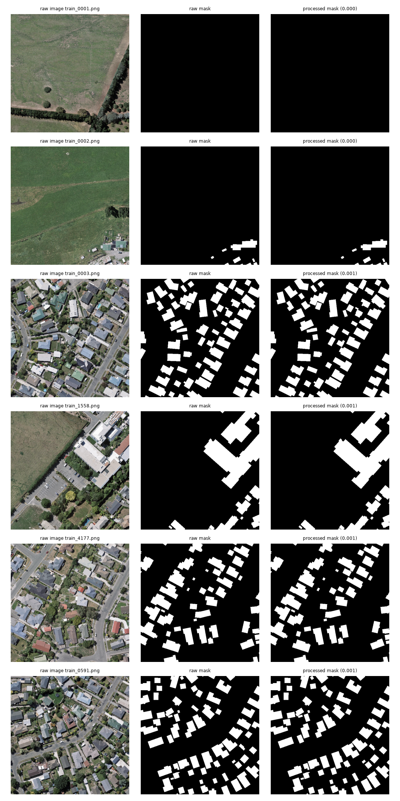
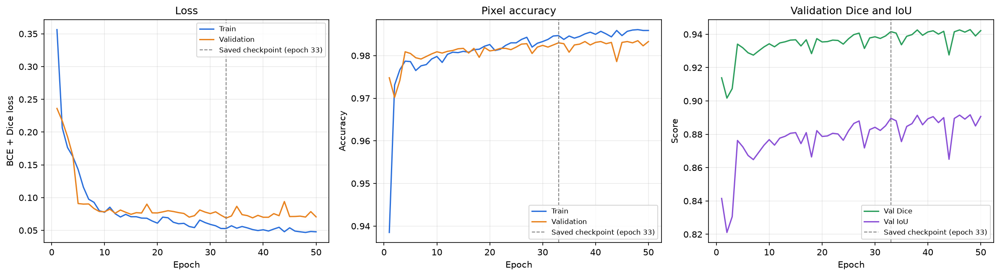
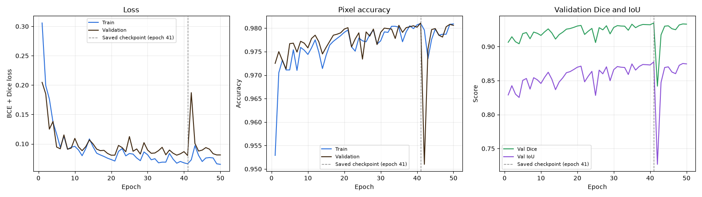
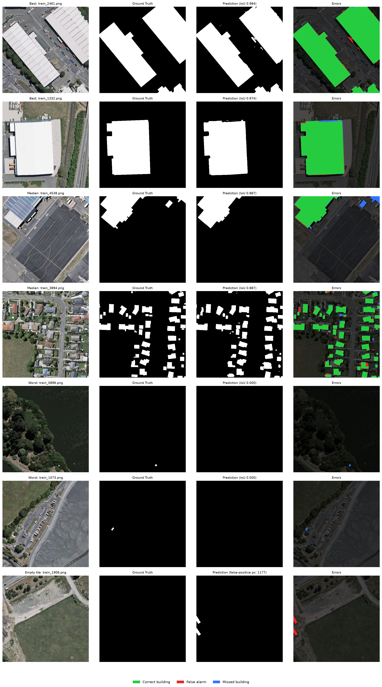
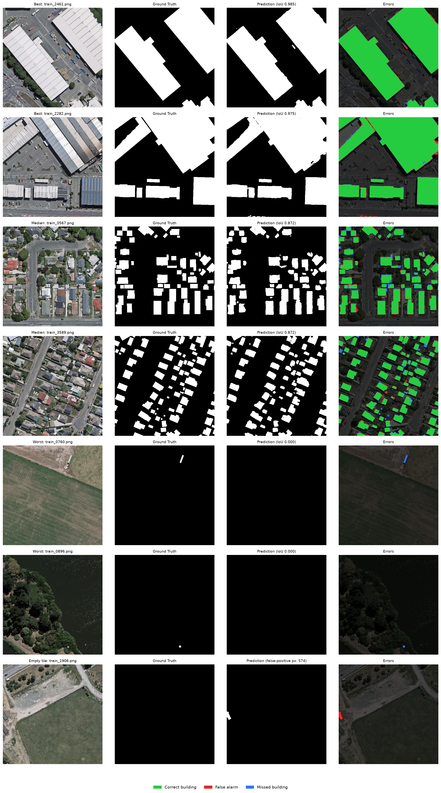
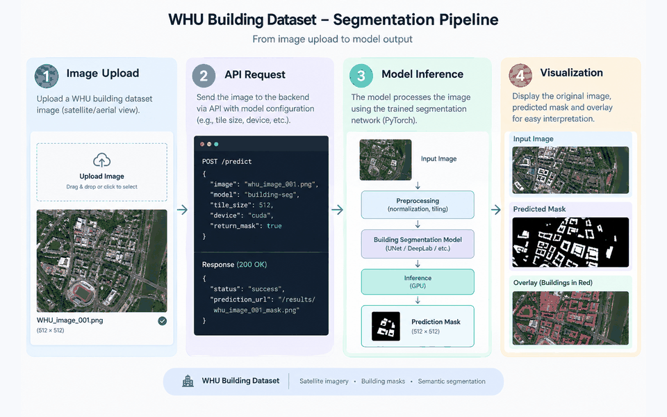

# 🛰️ Satellite Intelligence & Geospatial Computer Vision

> **An end-to-end Earth Observation computer vision system for satellite-image segmentation, building-footprint extraction, geospatial analysis, and multi-temporal change detection.**


## 📌 Overview

Satellite imagery provides a scalable way to monitor buildings, infrastructure, environmental changes, and urban development.

This project develops a **production-oriented computer vision pipeline for Earth Observation**, beginning with high-resolution satellite imagery and building-footprint segmentation and progressively extending toward:

* Transformer-based segmentation
* Geospatial polygon extraction
* Multi-temporal change detection
* Model evaluation and error analysis
* Optimized inference
* API-based deployment

The project is designed to bridge **deep learning research and practical ML engineering**.

### Core Pipeline

```text
                 Satellite Imagery
                        │
                        ▼
              ┌───────────────────┐
              │ Data Preprocessing│
              └─────────┬─────────┘
                        │
                        ▼
                 Image Tiling
                        │
                        ▼
              Building Segmentation
                        │
              ┌─────────┴─────────┐
              ▼                   ▼
        CNN Baseline       Transformer Model
              │                   │
              └─────────┬─────────┘
                        ▼
                Segmentation Mask
                        │
                        ▼
               Polygon Extraction
                        │
                        ▼
                Geospatial Output
                        │
                        ▼
              Multi-Temporal Analysis
                        │
                        ▼
                 Change Detection
                        │
                        ▼
               Deployment / API
```

---

# 🎯 Project Objectives

The primary objectives are to:

* Build a reproducible satellite-imagery data pipeline.
* Extract building footprints from high-resolution satellite imagery.
* Establish a CNN-based segmentation baseline.
* Evaluate transformer-based segmentation architectures.
* Convert segmentation masks into geospatial polygons.
* Investigate geographic generalization.
* Extend the pipeline toward multi-temporal change detection.
* Perform quantitative and qualitative error analysis.
* Develop an inference pipeline suitable for deployment.
* Investigate ONNX/TensorRT optimization where applicable.

---

# 🗺️ Project Demonstration

> **This section will be populated as the project develops.**

### End-to-End Demo

<!-- IMAGE/GIF PLACEHOLDER
Add a short GIF or video showing:

Satellite Image
      ↓
Model Inference
      ↓
Building Segmentation
      ↓
Polygon Extraction
      ↓
Final Geospatial Visualization
-->

**Coming soon:** A complete visual demonstration of the inference pipeline.

---

# 📊 Dataset

## WHU Building Dataset (Hugging Face)

The initial dataset is the **WHU Building Dataset** (aerial imagery subset), hosted on the Hugging Face Hub.

Hugging Face mirror:

**https://huggingface.co/datasets/giswqs/WHU-Building-Dataset**

Original source and paper:

**https://gpcv.whu.edu.cn/data/building_dataset.html**

> Ji, S., Wei, S., & Lu, M. *Fully Convolutional Networks for Multisource Building Extraction from an Open Aerial and Satellite Imagery Data Set.* IEEE TGRS.

**License:** CC-BY-4.0 (as listed on the Hugging Face dataset page).

The dataset provides high-resolution aerial imagery with pixel-level building masks, organized into `Image/` and `Mask/` folders per split. It is fully open, requires no account or special tooling, and downloads with a single command via `huggingface_hub`.

### Why this dataset

* Open license and one-command download (no archives to extract).
* Image/mask pairs ready for segmentation, so the focus stays on modeling.
* Building footprints cover a dense, real urban area with varied building sizes and shapes.
* Large enough to train a U-Net and a SegFormer baseline on a single GPU.

### Known Limitations

* The aerial subset covers a **single region (Christchurch, New Zealand)**, so cross-city generalization cannot be measured directly from this dataset alone (see *Spatial Generalization* below).
* Annotations are provided as **raster masks**, not vector GeoJSON. Polygons are derived from predicted masks in Phase 4 and are expressed in pixel coordinates unless the tiles carry georeferencing (checked by `src/data/download_dataset.py`).
* Only the `train` folder of the Hugging Face mirror was available, so it was split randomly 80/10/10 (seed 42) into train / validation / test (4586 / 573 / 573 tiles) during preprocessing. Because the split is random across tiles from one city, neighboring tiles can land in different splits, so the reported numbers are likely optimistic compared with a spatially disjoint split (see *Spatial Generalization* below).
* About 17% of tiles contain no buildings, and buildings make up roughly 15% of all pixels, so the classes are imbalanced and pixel accuracy alone is misleading.

### Dataset Structure

Conceptually:

```text
Aerial Image Tile
      +
Binary Building Mask
      │
      ▼
Preprocessing
      │
      ▼
Image Tile + Segmentation Mask
```

### Download

```bash
pip install huggingface_hub
py src/data/download_dataset.py          # train split
py src/data/download_dataset.py all      # full dataset
```

Data is stored under `data/raw/whu_building/`.

### Dataset Visualization

<!-- IMAGE PLACEHOLDER

Add a screenshot showing:

┌───────────────┬───────────────────┬──────────────────┐
│ Satellite     │ Building Polygons │ Rasterized Mask  │
│ Image         │                   │                  │
└───────────────┴───────────────────┴──────────────────┘

-->


---

# 🧭 Future Dataset — LEVIR-CD+

After establishing the initial segmentation pipeline, the project may be extended using **LEVIR-CD+**, a building change-detection dataset available on the Hugging Face Hub, for multi-temporal analysis.

Hugging Face mirror:

**https://huggingface.co/datasets/blanchon/LEVIR_CDPlus**

The objective is to investigate how bi-temporal imagery can be used to identify newly constructed or removed buildings. Dataset details (pair structure, mask format, license) will be confirmed from the dataset card before Phase 5 begins.

```text
Image T1 ───────────────┐
                        │
                        ▼
                  Feature Analysis
                        │
                        ▼
                 Change Detection
                        ▲
                        │
Image T2 ───────────────┘
```

---

# 🧠 Problem Definition

## Phase 1 — Building Footprint Segmentation

Given a satellite image:

```text
Input:
High-resolution satellite image

Output:
Pixel-level building segmentation mask
```

### Example

```text
Satellite Image
       │
       ▼
Segmentation Model
       │
       ▼
Building Mask
```

<!-- IMAGE PLACEHOLDER

Add:

Input Image | Ground Truth Mask | Model Prediction

-->

---

# 🛰️ Phase 2 — Geospatial Polygon Extraction

The segmentation mask will be transformed into structured building footprints.

```text
Segmentation Mask
       │
       ▼
Connected Components
       │
       ▼
Contour Extraction
       │
       ▼
Polygon Approximation
       │
       ▼
Building Footprints
```

### Example Output

<!-- IMAGE PLACEHOLDER

Show:

Satellite Image
+
Predicted segmentation
+
Extracted building polygons

-->

---

# 🕒 Phase 3 — Multi-Temporal Change Detection

The final stage investigates changes between satellite observations captured at different times.

Potential outputs include:

* Newly constructed buildings
* Removed buildings
* Modified building footprints
* Unchanged structures

### Before / After Visualization

<!-- IMAGE PLACEHOLDER

Add a side-by-side visualization:

Before → After → Detected Change

-->

---

# 🔬 Model Development

The project follows an incremental modeling strategy.

Rather than immediately adopting a complex architecture, a strong CNN baseline was established first and then compared against a transformer under the same training protocol.

---

## 1️⃣ CNN Baseline

The baseline is a U-Net with an ImageNet-pretrained ResNet18 encoder, built with `segmentation_models_pytorch`.

```text
Input Image
      │
      ▼
 CNN Encoder
      │
      ▼
Multi-scale Features
      │
      ▼
 U-Net Decoder
      │
      ▼
Building Mask
```

### Model Code Snapshot

```python
self.model = smp.Unet(
    encoder_name="resnet18",
    encoder_weights="imagenet",
    in_channels=3,
    classes=1,
)
```

---

## 2️⃣ Transformer-Based Segmentation

**SegFormer-B0** (`nvidia/mit-b0`) was trained under the same protocol. Its Mix Transformer encoder is ImageNet-pretrained and the decode head is newly initialized. SegFormer outputs logits at 1/4 of the input resolution, so they are upsampled to 512×512 and the same loss, trainer, and metrics apply unchanged.

```text
Satellite Image
      │
      ▼
Transformer Encoder
      │
      ▼
Multi-scale Representations
      │
      ▼
Segmentation Decoder
      │
      ▼
Building Mask
```

### Transformer Code Snapshot

```python
self.model = SegformerForSemanticSegmentation.from_pretrained(
    "nvidia/mit-b0", num_labels=1
)

def forward(self, x):
    logits = self.model(pixel_values=x).logits   # 1/4 resolution
    return F.interpolate(
        logits, size=x.shape[-2:],
        mode="bilinear", align_corners=False,
    )
```

---

# ⚖️ CNN vs Transformer

The project will compare the baseline and transformer architectures under consistent experimental conditions.

| Model                                   |    IoU |   Dice | Precision | Recall | F1 | Inference |
| --------------------------------------- | -----: | -----: | --------: | -----: | -: | --------: |
| CNN / U-Net, ResNet18 (validation)      | 0.8896 | 0.9416 |         — |      — |  — |         — |
| Transformer / SegFormer-B0 (validation) | 0.8775 | 0.9348 |         — |      — |  — |         — |

> Validation-set metrics at each model's saved checkpoint (U-Net: epoch 33, SegFormer-B0: epoch 41). Both models use the same splits, loss, optimizer, learning rate, batch size, and number of epochs. Precision, recall, F1, inference time, and test-set results will be added after the test evaluation. Metrics will only be added after the corresponding experiments have been completed.

### Comparison

* **The U-Net is ahead on validation:** Dice 0.9416 vs 0.9348 (+0.0068), IoU 0.8896 vs 0.8775 (+0.0121), and a lower validation loss (0.0688 vs 0.0801).
* **The gap is larger than typical epoch-to-epoch noise.** Over the last ten epochs the U-Net's validation Dice is mostly 0.939–0.943, while SegFormer-B0's is 0.925–0.933 from epoch 44 onward (after its epoch-42 spike).
* **Caveats:** one training run per model with no repeated seeds. SegFormer-B0 is the smallest SegFormer variant and was trained with the U-Net's learning rate without tuning. Checkpoints were selected by validation loss, so the validation numbers are slightly optimistic for both models. Test-set metrics are still to be added.
* The result therefore reads as "SegFormer-B0 did not beat the U-Net baseline under identical settings", not as a general statement about transformers.

### Qualitative Comparison

Per-model test-set figures are in *Error Analysis* below. Each figure selects its tiles by that model's own IoU, so a same-tile side-by-side comparison is still to be added.

<!-- IMAGE PLACEHOLDER

Add:

Ground Truth | CNN Prediction | Transformer Prediction

-->

---

# 🧪 Data Engineering Pipeline

A major focus of the project is making the dataset pipeline reproducible and reliable.

```text
Raw WHU Building Data
       │
       ▼
Mask Parsing & Binarization
       │
       ▼
Mask Validation
       │
       ▼
Image / Mask Alignment
       │
       ▼
Image Tiling / Cropping
       │
       ▼
Train / Validation / Test Split
       │
       ▼
PyTorch Dataset
```

### Preprocessing Visualization

<!-- IMAGE PLACEHOLDER

Show the transformation:

Original Aerial Image
        ↓
512×512 Tile (or smaller crops)
        ↓
Binary Building Mask
        ↓
Image / Mask Overlay
-->

---

# 💻 Representative Code

The README will include small code snippets that demonstrate important engineering decisions rather than reproducing entire source files.

## Example — Mask Loading

<!-- CODE PLACEHOLDER -->

```python
mask = load_binary_mask(
    mask_path,
    threshold=127
)
```

## Example — Model Inference

<!-- CODE PLACEHOLDER -->

```python
prediction = model(image)

building_mask = postprocess(
    prediction
)
```

## Example — Polygon Extraction

<!-- CODE PLACEHOLDER -->

```python
polygons = extract_building_polygons(
    building_mask
)
```

> Full implementations are available in the `src/` directory.

---

# 📈 Training & Evaluation

## Training Curves

### U-Net (ResNet18 encoder)



A U-Net with an ImageNet-pretrained ResNet18 encoder was trained for 50 epochs with a BCE + Dice loss. The dashed line marks epoch 33, the checkpoint with the lowest validation loss and the one saved as the baseline model.

| Saved checkpoint (epoch 33) |  Value |
| --------------------------- | -----: |
| Validation loss             | 0.0688 |
| Validation pixel accuracy   | 0.9830 |
| Validation Dice             | 0.9416 |
| Validation IoU              | 0.8896 |

* Training loss keeps falling while validation loss plateaus around 0.07. The gap is modest (0.048 vs 0.071 at epoch 50) and validation loss does not trend upward, so there is no strong overfitting.
* Validation metrics are noisy from epoch to epoch (for example the dip at epoch 44).
* The best validation Dice (0.9428, epoch 48) is within 0.0012 of the saved checkpoint.
* Pixel accuracy is dominated by background. Buildings are only about 15% of pixels, so predicting "no building" everywhere would already score roughly 84–85% accuracy. Dice and IoU are the metrics to read.

### SegFormer-B0



SegFormer-B0 (`nvidia/mit-b0`) was trained for 50 epochs with the same loss, optimizer, learning rate, and batch size. The dashed line marks epoch 41, the checkpoint with the lowest validation loss.

| Saved checkpoint (epoch 41) |  Value |
| --------------------------- | -----: |
| Validation loss             | 0.0801 |
| Validation pixel accuracy   | 0.9811 |
| Validation Dice             | 0.9348 |
| Validation IoU              | 0.8775 |

* Training loss falls steadily, while validation loss is noisier. The gap at epoch 50 is modest (0.065 vs 0.081) and validation loss does not trend upward.
* There is a one-epoch validation spike at epoch 42: validation loss jumps from 0.0801 to 0.1871 and Dice drops from 0.9348 to 0.8418, while training loss stays in its normal range (0.0728). Validation recovers by epoch 44. The saved checkpoint (epoch 41) comes just before the spike.
* After the spike, validation Dice does not return to its epoch-41 peak and settles around 0.925–0.933.

---

## Evaluation Metrics

### Segmentation Metrics

* Intersection over Union (IoU)
* Dice coefficient
* Precision
* Recall
* F1 score
* Pixel accuracy

### Object-Level Metrics

Where applicable:

* Building detection precision
* Building detection recall
* Polygon IoU
* Object-level F1
* False-positive count
* Missed-building count

### Efficiency Metrics

For deployment experiments:

* Inference latency
* Images per second
* Model size
* Memory usage
* Hardware requirements

---

# 🔍 Error Analysis

Model performance will not be evaluated solely through aggregate metrics.

Failure cases will be categorized and analyzed.

Potential categories include:

* Small buildings
* Dense urban regions
* Partially occluded buildings
* Shadows
* Low-contrast structures
* Complex building geometries
* Image artifacts
* Geographic domain shift

### Failure Case Visualization

#### U-Net (ResNet18 encoder)



#### SegFormer-B0



Tiles come from the test split and were chosen by per-tile IoU for each model (2 best, 2 median, 2 worst among tiles containing buildings, plus 1 empty tile), so each figure shows the range of behavior rather than a random sample. Because each figure selects tiles by its own model's IoU, most tiles differ between the two, and the median-tile IoUs (U-Net 0.887, SegFormer-B0 0.872) are not directly comparable. Columns: input, ground truth, prediction, and an error overlay (green = correct building, red = false alarm, blue = missed building).

What the examples show:

* Both models segment large, simple roofs such as industrial buildings almost perfectly (best tiles: IoU 0.984 and 0.974 for the U-Net, 0.985 and 0.975 for SegFormer-B0).
* Dense residential tiles sit around IoU 0.87–0.89, with errors on small outbuildings and along building edges. SegFormer-B0's predicted outlines appear softer and rounder, which fits its 1/4-resolution output.
* Both models miss the tiny buildings in their worst tiles (a handful of building pixels, IoU 0.00), and both miss the same tile (`train_0896`). Very small buildings are the clearest failure mode for both.
* On the one empty tile shown for both models (`train_1906`), each produces a small false alarm near the tile edge: 1,177 pixels for the U-Net and 574 for SegFormer-B0.
* On the shared tile `train_2461`, the two models score almost identically (IoU 0.984 vs 0.985).

These are qualitative observations from seven tiles per model, only three of which are shared. A quantitative breakdown by building size and tile type is still to be done.

---

# 🌍 Spatial Generalization

One of the important questions in satellite-image ML is whether a model trained on one area generalizes to another.

The WHU aerial subset covers a single region, so the project will investigate generalization in two ways:

```text
Spatially disjoint split (same city, non-overlapping areas)
        │
        ▼
       Model
        │
        ├──────────► Held-out area evaluation
        │
        └──────────► Optional cross-dataset evaluation
                     (e.g. INRIA Aerial Image Labeling on Hugging Face)
```

This helps distinguish memorization of local appearance from genuine visual generalization. Cross-dataset evaluation is optional and will only be reported if actually performed.

---

# 🧩 Project Architecture

The project follows a modular ML-system design.

```text
                 ┌──────────────────┐
                 │ Satellite Images │
                 └────────┬─────────┘
                          │
                          ▼
                ┌────────────────────┐
                │ Data Preprocessing │
                └─────────┬──────────┘
                          │
                          ▼
                   ┌─────────────┐
                   │ Image Tiling│
                   └──────┬──────┘
                          │
                          ▼
                ┌─────────────────────┐
                │ Dataset / DataLoader│
                └──────────┬──────────┘
                           │
              ┌────────────┴────────────┐
              ▼                         ▼
       ┌────────────┐            ┌──────────────┐
       │ CNN Model  │            │ Transformer  │
       │ Baseline   │            │    Model     │
       └──────┬─────┘            └──────┬───────┘
              │                         │
              └────────────┬────────────┘
                           ▼
                  ┌─────────────────┐
                  │ Model Evaluation│
                  └────────┬────────┘
                           │
                           ▼
                ┌────────────────────┐
                │ Polygon Extraction │
                └─────────┬──────────┘
                          │
                          ▼
                  ┌───────────────┐
                  │ Geospatial    │
                  │ Visualization │
                  └───────┬───────┘
                          │
                          ▼
                 ┌─────────────────┐
                 │ Change Detection│
                 └─────────────────┘
```

### Architecture Diagram

<!-- IMAGE PLACEHOLDER

Replace the ASCII architecture above with a professionally designed architecture diagram once the implementation stabilizes.

-->

---

# 📁 Repository Structure

```text
satellite-intelligence/
│
├── configs/
│   └── config.yaml
│
├── data/
│   ├── raw/
│   └── processed/
│       ├── train/
│       ├── val/
│       └── test/
│
├── results/
│   ├── visualizations/
│   │   ├── learning_curves.png
│   │   ├── learning_curves_transformer.png
│   │   ├── whu_test_predictions.png
│   │   └── whu_test_predictions_transformer.png
│   │
│   ├── diagrams/
│   │   └── system_architecture.png
│   │
│   └── demos/
│       ├── end_to_end_demo.gif
│       └── api_demo.gif
│
├── src/
│   ├── code/
│   │   ├── __init__.py
│   │   ├── alignment_check.py
│   │   ├── check_masks.py
│   │   ├── dataset_visualization.py
│   │   ├── dataset.py
│   │   ├── loss.py
│   │   ├── metrics.py
│   │   ├── model.py
│   │   ├── trainer.py
│   │   └── preprocessing.py
│   │
│   ├── data/
│   │   └── download_dataset.py
│   │
│   ├── visualization & Evaluation/
│   │   ├── visualize_unet.py
│   │   └── visualize-segmentation_transformer.py
│   │
│   ├── inference/
│   │   └── predictor.py
│   │
├── api/
│   └── app.py
│
├── tests/
│
├── train.py
├── mask_check.png
├── unet_best_model.pth
├── unet_training_log.csv
├── segformer_mit-b0_best_model.pth
├── segformer_mit-b0_training_log.csv
├── requirements.txt
├── Dockerfile
└── README.md
```

---

# 🚀 Deployment

The final stage will explore deployment of the trained model as an inference service.

```text
Satellite Image
       │
       ▼
     FastAPI
       │
       ▼
 Model Inference
       │
       ▼
Segmentation Mask
       │
       ▼
Polygon Extraction
       │
       ▼
Geospatial Response
```

### API Demo

The following animation illustrates the end-to-end workflow, from
image upload and model inference to building-mask visualization.



---

# ⚡ Model Optimization

Where supported by the selected architecture, the project will investigate:

```text
PyTorch Model
      │
      ▼
    ONNX
      │
      ▼
ONNX Runtime
      │
      ▼
TensorRT
      │
      ▼
Optimized Inference
```

Performance will be measured rather than assumed.

### Benchmark

| Model     | Input Size | Latency | FPS | Memory |
| --------- | ---------: | ------: | --: | -----: |
| Baseline  |          — |       — |   — |      — |
| Optimized |          — |       — |   — |      — |

---

# 🧪 Reproducibility

Both models were trained with the settings below (only the `model` block differs). Training settings are currently set in the training script; moving them into a YAML config is planned.

```yaml
dataset:
  name: whu_building
  tile_size: 512            # images and masks resized to 512x512
  split: random 80/10/10, seed 42   # 4586 / 573 / 573 tiles

training:
  batch_size: 4
  gradient_accumulation_steps: 2    # effective batch size 8
  epochs: 50
  optimizer: AdamW
  learning_rate: 0.0001
  weight_decay: 0.0001
  loss: BCE + Dice (0.5 / 0.5)
  mixed_precision: true             # on CUDA

model:                              # two separate runs
  - architecture: unet
    encoder: resnet18               # ImageNet-pretrained
    library: segmentation_models_pytorch
  - architecture: segformer
    pretrained: nvidia/mit-b0       # ImageNet-pretrained encoder, new decode head
    library: transformers

evaluation:
  checkpoint_selection: lowest validation loss
  threshold: 0.5
  metrics_so_far:
    - iou
    - dice
    - pixel_accuracy
  planned_on_test:
    - precision
    - recall
    - f1
```

---

# 🔬 Research Questions

### RQ1

How effectively can deep-learning models extract building footprints from high-resolution satellite imagery?

### RQ2

How does a transformer-based segmentation architecture compare with a CNN-based baseline?

### RQ3

How well do models generalize to spatially held-out areas, and optionally to a different dataset?

### RQ4

How accurately can pixel-level predictions be converted into usable geospatial building polygons?

### RQ5

Can multi-temporal satellite imagery be used to identify urban development and structural changes?

### RQ6

What is the trade-off between segmentation accuracy and inference efficiency?

---

# 🛠️ Technology Stack

### Programming

* Python 3.x

### Deep Learning

* PyTorch
* torchvision
* segmentation_models_pytorch
* Hugging Face Transformers

### Computer Vision

* OpenCV
* Pillow
* Albumentations

### Geospatial

* Rasterio
* GeoPandas
* Shapely
* GDAL

### Data & Analysis

* NumPy
* Pandas
* Hugging Face Hub (`huggingface_hub`)
* Matplotlib
* Jupyter

### Engineering

* Git
* Docker
* pytest
* YAML configuration
* Structured logging
* Modular/OOP architecture

### Deployment

* FastAPI
* ONNX
* ONNX Runtime
* TensorRT

---

# 🗺️ Development Roadmap

## Phase 0 — Project Setup

- [x] Define project specification
- [x] Create repository structure
- [x] Configure Python environment
- [x] Configure logging
- [x] Add configuration system
- [x] Document dataset acquisition

---

## Phase 1 — Dataset Engineering

* [x] Download WHU Building Dataset from Hugging Face
* [x] Inspect imagery
* [x] Inspect building masks
* [x] Validate image/annotation alignment
* [x] Binarize and validate masks
* [x] Resize images and masks to 512×512
* [x] Create train/validation/test splits
* [x] Build PyTorch Dataset
* [x] Visualize annotations

**Documentation milestone:**

* [x] Dataset visualization screenshot
* [x] Preprocessing visualization
* [x] Dataset pipeline diagram

---

## Phase 2 — CNN Baseline

* [x] Implement segmentation model
* [x] Implement training pipeline
* [x] Implement loss functions
* [x] Train baseline
* [x] Evaluate metrics
* [x] Generate prediction visualizations
* [x] Perform error analysis

**Documentation milestone:**

* [x] Training curves
* [x] Prediction examples
* [x] Failure cases
* [x] Baseline metrics

---

## Phase 3 — Transformer Segmentation

* [x] Implement/adapt SegFormer
* [x] Establish consistent evaluation protocol
* [x] Train transformer model
* [x] Compare against CNN baseline
* [x] Analyze performance differences

**Documentation milestone:**

* [ ] Architecture diagram
* [x] CNN vs Transformer table
* [ ] Qualitative comparison
* [x] Error analysis

---

## Phase 4 — Geospatial Extraction

* [ ] Convert masks to polygons
* [ ] Extract building contours
* [ ] Filter false-positive regions
* [ ] Simplify polygons where appropriate
* [ ] Compare predictions with ground truth
* [ ] Generate geospatial visualizations

**Documentation milestone:**

* [ ] Polygon extraction visualization
* [ ] Object-level metrics
* [ ] Geospatial output example

---

## Phase 5 — Multi-Temporal Change Detection

* [ ] Investigate LEVIR-CD+ (Hugging Face)
* [ ] Understand temporal annotations
* [ ] Build temporal preprocessing pipeline
* [ ] Establish change-detection baseline
* [ ] Investigate temporal architectures
* [ ] Visualize detected changes

**Documentation milestone:**

* [ ] Before/after comparison
* [ ] Change map
* [ ] Temporal model diagram
* [ ] Quantitative results

---

## Phase 6 — Deployment & Optimization

* [ ] Build inference interface
* [ ] Develop FastAPI service
* [ ] Containerize with Docker
* [ ] Export model to ONNX
* [ ] Benchmark inference
* [ ] Investigate TensorRT
* [ ] Document accuracy/latency trade-offs

**Documentation milestone:**

* [x] API demo GIF
* [ ] Latency benchmark
* [ ] Deployment architecture
* [ ] End-to-end demo

---

# 📸 Documentation Strategy

This repository will be documented progressively as the system is built.

Every major development phase should contribute at least one visual artifact.

| Phase            | Documentation                |
| ---------------- | ---------------------------- |
| Dataset          | Image + annotations          |
| Preprocessing    | Transformation visualization |
| Baseline         | Training curves              |
| Segmentation     | Prediction comparison        |
| Transformer      | Architecture + comparison    |
| Geospatial       | Polygon overlay              |
| Change Detection | Before/after/change map      |
| Deployment       | API/GIF demo                 |
| Optimization     | Benchmark table              |

This prevents the README from becoming a collection of unsupported claims and ensures that reported results correspond to actual experiments.

---

# 📊 Final Results

Validation results for both models are below. Test-set results will be added after the corresponding evaluation is completed.

## Model Performance

| Model                         |    IoU |   Dice | Precision | Recall | F1 |
| ----------------------------- | -----: | -----: | --------: | -----: | -: |
| CNN Baseline / U-Net (validation) | 0.8896 | 0.9416 |         — |      — |  — |
| Transformer / SegFormer-B0 (validation) | 0.8775 | 0.9348 |         — |      — |  — |

> Validation-set metrics at each model's saved checkpoint (U-Net: epoch 33, SegFormer-B0: epoch 41). Test-set evaluation, including precision, recall, and F1, is still to be added.

## Deployment Performance

| Configuration | Latency | FPS | Memory |
| ------------- | ------: | --: | -----: |
| Baseline      |       — |   — |      — |
| Optimized     |       — |   — |      — |

> No performance numbers will be added until they are obtained from actual experiments.

---

# 🌍 Potential Applications

The techniques developed in this project can support applications such as:

* Infrastructure monitoring
* Urban development analysis
* Disaster assessment
* Satellite image intelligence
* Earth observation
* Geographic information systems
* Environmental monitoring
* Remote sensing
* Autonomous systems
* Space technology

---

# 🔭 Future Extensions

Potential future directions include:

* Road extraction
* Flood mapping
* Disaster-response mapping
* Multi-spectral imagery
* SAR imagery
* Cross-modal satellite image registration
* Cloud detection
* Self-supervised remote-sensing representation learning
* Earth Observation foundation models
* Vision Transformers
* Multi-modal satellite analytics
* Edge inference

---

# 📚 References & Dataset Sources

### WHU Building Dataset (Hugging Face)

https://huggingface.co/datasets/giswqs/WHU-Building-Dataset

### WHU Building Dataset (original source)

https://gpcv.whu.edu.cn/data/building_dataset.html

### LEVIR-CD+ (Hugging Face)

https://huggingface.co/datasets/blanchon/LEVIR_CDPlus

---

# 📌 Project Status

🚧 **In Development**

**Completed:** Phase 0 (setup), Phase 1 (dataset engineering), Phase 2 (U-Net baseline: validation Dice 0.9416, IoU 0.8896), and Phase 3 (SegFormer-B0 comparison: validation Dice 0.9348, IoU 0.8775).

**Next:** Phase 4 (geospatial polygon extraction), plus a held-out test-set evaluation of both models (precision, recall, F1).

> **WHU Building Dataset → Dataset Engineering → Building Segmentation Baseline → Transformer Comparison → Geospatial Extraction**

Results and visualizations will be added progressively as each experiment is completed.

---

# 👨‍💻 Author

**Ishaan Pathak**

MS in Computer Science

### Interests

* Machine Learning
* Computer Vision
* Multimodal AI
* Remote Sensing
* Earth Observation
* Autonomous Systems
* Space Technology

---

## ⭐ Project Vision

The long-term objective is to develop an end-to-end system demonstrating how modern computer vision can transform raw satellite imagery into actionable geospatial information.

```text
Raw Satellite Data
        ↓
Data Engineering
        ↓
Computer Vision
        ↓
Deep Learning
        ↓
Geospatial Intelligence
        ↓
Temporal Analysis
        ↓
Deployment
```

> **From pixels to geospatial intelligence.**